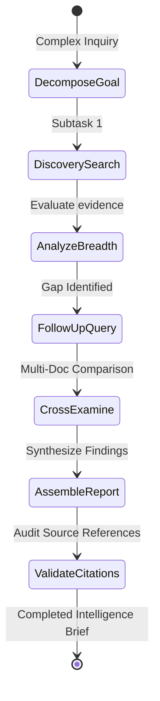

# DocuMind AI — Agentic Research Orchestrator

## Overview
DocuMind's Agentic Research Orchestrator transforms multi-document inquiries into an autonomous, bounded investigation. Unlike basic single-turn RAG queries, the research agent operates as a state machine that can iteratively formulate sub-questions, invoke specialized tools, compare cross-document evidence, and compile structured reports.

## Safety & Bounded Guarantees
1. **Strict Iteration Caps**: Execution cannot exceed `AGENT_MAX_ITERATIONS` (default: 4-5).
2. **Tool Call Budgets**: Maximum tool executions capped at `AGENT_MAX_TOOL_CALLS` (default: 8-10).
3. **Execution Timeout**: Enforces hard execution timeouts to prevent infinite loops.
4. **Sandboxed Capabilities**: The agent interacts exclusively with specialized information retrieval tools. It has **no access** to shell commands, Python execution, arbitrary file operations, or raw database writes.
5. **No Hallucinated Tool Executions**: Every logged tool call corresponds to an actual executed function with persisted inputs and outputs.

## Available Agent Tools

| Tool Name | Purpose | Output |
| :--- | :--- | :--- |
| `search_documents` | Semantic and keyword search across collection | Ranked text excerpts with page provenance |
| `extract_evidence` | Extracts atomic assertions on targeted topics | Bulleted factual findings |
| `compare_sources` | Cross-references findings across distinct files | Grouped document perspectives |
| `validate_source_claim` | Verifies whether a statement is supported by source text | Verification status (`supported`, `tentative`) |

## Structured Intelligence Brief Generation
At the conclusion of each bounded task, the agent outputs:
- **Executive Summary**: High-level synthesis of findings.
- **Core Findings by Source**: Excerpts linked directly to source documents and page numbers.
- **Cross-Source Agreements & Divergence**: Explicit comparisons across files.
- **Limitations & Unresolved Inquiries**: Explicit documentation of what the document corpus could not answer.
