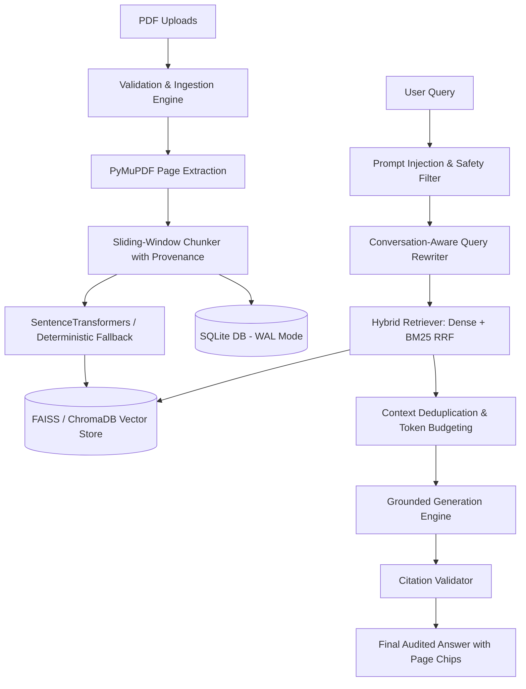

# DocuMind AI — Architectural Specification

## System Overview
DocuMind AI is an enterprise document intelligence and verifiable RAG platform that transforms unstructured PDFs into connected, auditable, and actionable knowledge.

Product Tagline: *"From Documents to Decisions."*

## Key Architectural Layers

### 1. Ingestion & Document Processing Layer (`core/pdf_processor.py`, `core/chunker.py`)
- **PyMuPDF Extraction**: Extracts text page-by-page, strictly maintaining 1-indexed page boundaries.
- **SHA-256 Hashing**: Generates cryptographic hashes of uploaded PDF byte-streams for duplicate indexing detection.
- **Scanned PDF Detection**: Evaluates character density per page to flag scanned documents.
- **Table Extraction**: Detects structured tabular data blocks and associates them with source page metadata.
- **Sentence-Aware Sliding Chunker**: Splits pages along sentence boundaries while preserving a configurable overlap. Each chunk inherits `document_id`, `page_number`, `chunk_index`, and `content_hash`.

### 2. Dual Vector Store Architecture (`core/vector_store.py`)
- **FAISS Backend**: In-memory and flat-file vector search using `IndexFlatIP` on L2-normalized 384-dimensional vectors (equivalent to cosine similarity).
- **ChromaDB Backend**: Collection-oriented vector database with persistent HNSW cosine index and native metadata filtering.
- **Unified VectorStoreInterface**: Decouples application logic from the underlying vector library.

### 3. Hybrid Retrieval & Fusion (`core/hybrid_retriever.py`)
- **Dense Semantic Retrieval**: Embeds the rewritten query into vector space to capture conceptual meaning.
- **BM25 Keyword Retrieval**: Tokenized lexical frequency matching via `rank_bm25.BM25Okapi`.
- **Reciprocal Rank Fusion (RRF)**: Merges rank positions using:
  $$RRF(d) = \sum_{m \in \{dense, bm25\}} \frac{w_m}{k + \text{rank}_m(d)}$$
- **Lexical Re-ranking**: Evaluates keyword phrase coverage across candidate chunks to break ties.

### 4. Relational Knowledge Core (`core/database.py`)
- Persistent single-file database (`documind.db`) operated under Write-Ahead Logging (`PRAGMA journal_mode = WAL`).
- Tables: `collections`, `documents`, `chunks`, `conversations`, `messages`, `claims`, `entities`, `relationships`, `document_versions`, `research_tasks`, `evaluation_records`, `audit_events`.
- Foreign key cascading deletes ensure that purging a document eliminates its chunks, claims, and relational links cleanly.

### 5. Multi-Provider LLM Abstraction (`core/llm_provider.py`)
- **Extractive Local Provider**: Runs 100% offline with zero external API dependencies. Extractively identifies high-salience factual sentences, assembles verified citations, and prevents hallucination.
- **Cloud Providers**: Seamless support for OpenAI (GPT-4o-mini), Google Gemini (2.5 Flash), and local Ollama instances.

### 6. Design System & Aesthetics (`design_system.py`)
- Built upon the **"Eliza" Architectural Palette**:
  - Obsidian (`#151618`)
  - Charcoal Silk (`#3C4449`)
  - Shadowed Ash (`#62676B`)
  - Cool Concrete (`#8D9295`)
  - Morning Mist (`#CED3D6`)
  - Architectural White (`#FFFFFF`, `#F7F8F9`)
